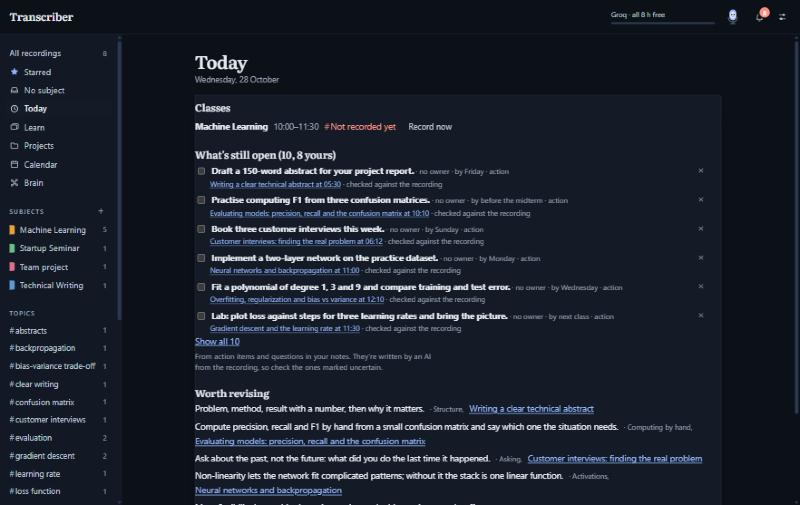
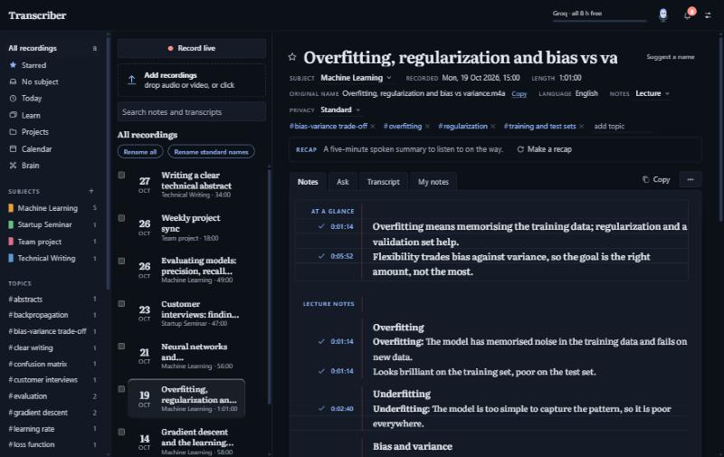
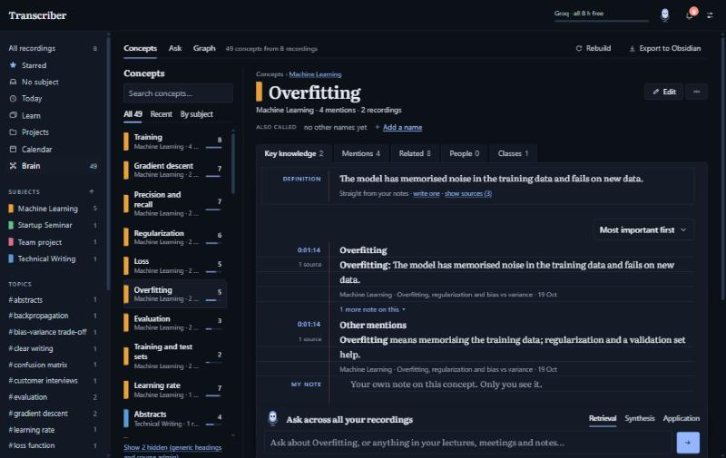

# Transcriber

**A local-first notebook for lectures and meetings.** Drop in a recording and get a timestamped transcript, study notes
that cite the exact moment each point was said, and a second brain that connects everything you have learned.

The notes are written by one model and **fact-checked against the transcript by a model from a different company**, so
every point comes with a verdict you can trust. Your recordings, notes and database live in a folder on your own
computer; nothing is sent anywhere you have not approved.



## What it does

| | |
|---|---|
| **Transcribe** | Whisper large-v3 (via Groq) for speed, Gemini for English mixed with another language in the same sentence, an optional on-device model for recordings that must never leave the laptop, and your own GPU server for speaker labels. |
| **Notes you can check** | Lecture notes by topic (definitions, examples, what the lecturer stressed), or meeting notes (decisions, action items, open questions). Each point links to the moment it was said and carries the checker's verdict. |
| **Ask** | Chat about one recording, or across all of them, in three modes: look something up, synthesise across lectures, or apply an idea to a new problem. |
| **Brain** | A concept index built from your notes: definitions in your own terms, where each idea came up, a concept map, your own notes on a concept, and a conflict-safe Obsidian export. |
| **Learn** | Flashcards from your own definitions on an FSRS-5 spaced-repetition schedule, plus teach-back: explain an idea in your own words and see what your lectures say you got right or left out. |
| **Today, Calendar, Projects** | Your day on one page, class timetables with missed-class detection, and projects that tie recordings, people, concepts and tasks together. |
| **Pip** | A small assistant that edits your calendar and reminders (every change has an Undo) and remembers what you tell it. |
| **Translate** | One click turns a transcript in another language, or a mixed-language one, into English, paragraph by paragraph, keeping every timestamp. |
| **Privacy gateway** | Every send to a cloud provider is checked against approvals you set per provider and per recording (Standard, Private, Local only), and logged. Nothing leaves without a yes. |



## Try it in two minutes, with no accounts or keys

The repository ships **no personal data**. A script makes a library of invented lectures (a machine learning course, a
technical writing class, a startup seminar and a team meeting) so you can click around the real interface:

```
pip install -r requirements.txt
python scripts/seed_demo.py
python scripts/demo_server.py
```

Then open http://127.0.0.1:8001. The demo uses fake transcription and fake AI replies, so it never calls an outside service.



## Run it for real

1. Install **Python 3.11 or newer**.
2. Make a free key at [console.groq.com](https://console.groq.com) (transcription and notes) and, optionally, a Gemini
   key at [aistudio.google.com](https://aistudio.google.com/apikey) (notes checker and mixed-language transcription).
3. Copy `.env.example` to `.env` and paste the keys in. On Windows, `start.bat` does the setup for you.
4. `python -m transcriber` and open http://127.0.0.1:8000.

The step-by-step guide is in [docs/user-guide.md](docs/user-guide.md); [docs/privacy.md](docs/privacy.md) explains the
approvals; [docs/offline.md](docs/offline.md) covers the on-device model.

## Your own language

English is the default. Add any language Whisper supports in `.env`, and name the other language of mixed lectures:

```
EXTRA_LANGUAGES=es:Spanish,fr:French
SECOND_LANGUAGE=Spanish
```

The language menus, the mixed-language option, the Roman-letter conversion and the English translation all follow
those two settings; nothing in the code is tied to one language. Details are in [docs/user-guide.md](docs/user-guide.md).

## Integrations

Your data is yours to take elsewhere. Today the app can export:

- **Obsidian:** your Brain as a vault of linked Markdown pages. Exporting again never overwrites a page you edited.
- **Calendar:** class timetables and reminders as an `.ics` file for Google, Apple or Outlook.
- **Anki:** your flashcards as an importable text file.

Everything is a plain file made on your computer; no account is needed. New integrations are small modules in
`transcriber/integrations.py`, so adding another (Notion, Zotero and so on) is a contained change. Details are in
[docs/integrations.md](docs/integrations.md).

## Cloud models and local models

Use whichever mix suits you, per recording:

- **Cloud models:** Whisper large-v3 on Groq for fast transcription, Gemini for mixed-language speech and the notes
  checker, and Groq, Cerebras, OpenRouter, OpenAI or Gemini for writing notes and answering questions. Most have free
  tiers. You choose each one in `.env` with a `provider:model` line and paste in your own keys.
- **Local models:** transcription on your own machine, as described below.

You decide per recording which kind may touch it (Standard, Private or Local only), and the privacy gateway enforces it.

### Running locally

Nothing has to leave your computer if you don't want it to:

- **Transcription on this machine.** Set `LOCAL_TRANSCRIBER=small` (or another Whisper size) in `.env`, and recordings
  marked *Local only* are transcribed on your laptop with no network call. See [docs/offline.md](docs/offline.md).
- **Your own server.** `server/` is a small transcription server you can run on a GPU machine you control; the app sends
  audio there and gets back a transcript with speaker labels.
- **The privacy gateway** keeps *Private* and *Local only* recordings away from every cloud provider, whichever of the
  above you use.

Running the notes, checker and Ask models locally (for example through Ollama, LM Studio or llama.cpp) is the next step:
see the roadmap below.

## Roadmap

- **A local-only Brain** (in progress): a knowledge base for your material, recordings and content that is built, stored
  and searched entirely on your computer, with no cloud model involved.
- **Local language models** for notes, fact-checking and Ask, behind the same `provider:model` setting.
- **Master notes**: one document per subject, merged by topic across every lecture and class.
- **A native Mac and iPhone app** with live transcription, using on-device speech and language models.
- **Phone access** to your library away from home, over a private network, with the same approvals.
- **Audio recaps**: a short spoken summary of a day or a topic, generated from your notes.

## How it is built

- **Backend:** FastAPI and SQLite (one file, forward-only migrations tracked with `PRAGMA user_version`, a backup written
  before each upgrade). Background workers for transcription, notes, recaps and the concept index.
- **Frontend:** vanilla JavaScript with a tiny DOM helper and no build step. The design system, a printed "study sheet"
  with three pens and no cards, is written up in [DESIGN.md](DESIGN.md).
- **Providers behind small interfaces** (`transcriber/providers`, `transcriber/llm`): swap Groq, Cerebras, OpenRouter,
  OpenAI, Gemini or a local model by changing a line in `.env`.
- **A privacy gateway** (`transcriber/privacy.py`) wraps every provider client. A request is allowed only if the
  provider is approved for the recording's class, provenance is traced through merged recordings, and each decision is
  logged without any recording content.
- **The app answers only on this computer.** It binds to `127.0.0.1` and refuses requests addressed to any other host
  name and posts from other sites, so a web page you visit cannot drive it.
- **Tests:** about 700, all against fake providers, so the suite needs no network and no keys:

```
pip install -r requirements-dev.txt
python -m pytest
```

## Project map

```
transcriber/            the app: api (app.py), store, pipeline, notes, brain, learn, privacy, providers, static UI
transcriber/static/     the interface (index.html, one script per screen, styles.css)
server/                 an optional transcription server for your own GPU, with speaker labels
scripts/                demo data, a demo server, exports
docs/                   guides for each feature
tests/                  the test suite
```

## License

MIT. See [LICENSE](LICENSE).
